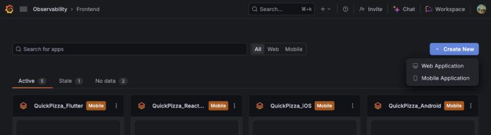
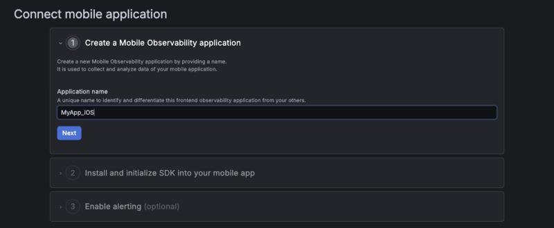
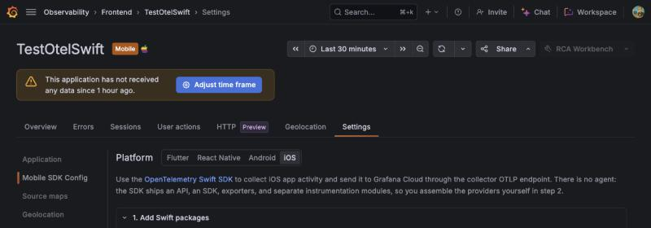
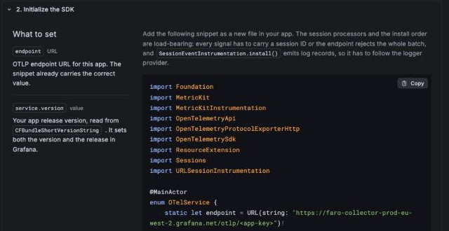
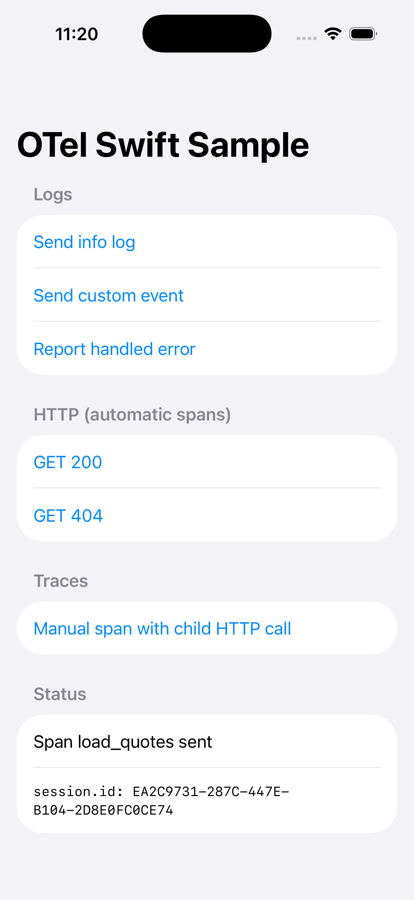

# OpenTelemetry Swift → Grafana Frontend Observability (iOS)

A tiny SwiftUI app that sends logs, events, errors, manual spans and automatic HTTP spans to
Grafana Frontend Observability, using **plain OpenTelemetry Swift** — no Grafana SDK.

Everything that matters is in one file: [`OTelSwiftSample/OTel.swift`](OTelSwiftSample/OTel.swift).
Copy it into your own app and follow the steps below.

> **Status:** private preview. Tested with `opentelemetry-swift` 2.6.0, Xcode 27.1, iPhone 17 Pro
> Simulator (iOS 26.5), against a production Grafana Cloud stack.

## Run the sample (5 minutes)

1. **Create the app in Grafana.** In Frontend Observability, click **Create New → Mobile Application**.

   

   Give it a name and click **Next**.

   

2. **Copy the OTLP endpoint.** Open the app, go to **Settings → Mobile SDK Config**, and pick **iOS**.

   

   Under **2. Initialize the SDK**, copy the URL from `static let endpoint`. It already has the
   right format, with `/otlp/` and your app key:

   ```text
   https://faro-collector-<region>.grafana.net/otlp/<app-key>
   ```

   

   Use this URL, not the `/collect/` URL used by the Faro SDKs.

3. **Paste it** into `OTelConfig.otlpEndpoint` in [`OTel.swift`](OTelSwiftSample/OTel.swift).
4. **Open** `OTelSwiftSample.xcodeproj`, pick an iPhone Simulator, press **Run**.
   Xcode downloads the packages on the first build.
5. **Tap every button** in the app.

   
6. **Open your app in Frontend Observability.** Sessions, logs, errors and HTTP requests appear
   within a minute. The session ID on screen matches the one in Grafana.

## Add it to your own app

### 1. Add two Swift packages

Xcode → **File → Add Package Dependencies…**. Use **Up to Next Minor Version** from `2.6.0` for both.

| Package URL | Products to add |
| --- | --- |
| `https://github.com/open-telemetry/opentelemetry-swift-core.git` | `OpenTelemetryApi`, `OpenTelemetrySdk` |
| `https://github.com/open-telemetry/opentelemetry-swift.git` | `OpenTelemetryProtocolExporterHTTP`, `Sessions`, `URLSessionInstrumentation`, `ResourceExtension`, `MetricKitInstrumentation` |

Why both: the API and SDK live in the `-core` package; exporters and instrumentation live in the
main one. Xcode does not offer the core products unless you add the core package yourself.

Why 2.6.x: that is the tested release, and both packages must be on the same version. Do not use
the gRPC exporter: the endpoint only accepts OTLP over HTTP.

### 2. Copy `OTel.swift` and set two values

```swift
static let otlpEndpoint = "https://faro-collector-<region>.grafana.net/otlp/<app-key>"
static let environment = "production"
```

- `otlpEndpoint`: the URL from step 2 above. No API token is needed; the app key in the path is the credential.
- `environment`: keeps production and staging apart.

### 3. Start it from your `App`

```swift
@main
struct MyApp: App {
    init() { OTel.start() }   // first thing, on the main thread

    var body: some Scene {
        WindowGroup { RootView() }
    }
}
```

### 4. Send your own telemetry

`OTel.swift` has small helpers for the common cases. See [`ContentView.swift`](OTelSwiftSample/ContentView.swift).

```swift
// Log
OTel.log("Checkout started")
OTel.log("Cart is empty", severity: .warn, attributes: ["screen": .string("cart")])

// Event
OTel.event("add_to_cart", attributes: ["item": .string("margherita")])

// Handled error (crashes are reported automatically)
do { try pay() } catch { OTel.logException(error) }

// Manual span; any URLSession request made before end() becomes a child span
let span = OTel.startSpan("load_cart")
// ... work ...
span.end()
```

The helpers are a few lines each, on top of the standard OpenTelemetry API. Use `OTel.logger` and
`OTel.tracer` directly when you need more control.

HTTP requests through `URLSession` (including `URLSession.shared`) are traced automatically, and get a
W3C `traceparent` header that links them to your backend traces.

**Skip hosts you don't want traced**, for example a third-party SDK's API. Extend `shouldInstrument` in `OTel.swift`:

```swift
shouldInstrument: { request in
    guard let host = request.url?.host else { return true }
    let ignored = ["analytics.example.com", "ads.example.net"]   // matches subdomains too
    return host != endpoint.host && !ignored.contains { host.hasSuffix($0) }
},
```

## The rules that make data show up

If you change the setup, keep these. Most cause "I see no data"; the rest cause confusing or unwanted data.

| Rule | What happens if you skip it |
| --- | --- |
| Use the `/otlp/<app-key>` URL from Frontend Observability | Data sent to the Grafana Cloud OTLP gateway (`otlp-gateway-*`) lands in Loki/Tempo but **never** in Frontend Observability. |
| Append `/v1/traces` and `/v1/logs` to the URL | OTel Swift posts to the exact URL you give it. Unlike OTel Android or other SDKs, it never adds the signal path, so a bare `/otlp/<app-key>` URL receives nothing. |
| `SessionSpanProcessor` + `SessionLogRecordProcessor` | Every record must carry `session.id`. One record without it and the **whole batch is rejected**, silently. |
| `SessionConfig(15 min, 4 h, restorePersistedSession: false)` | The SDK defaults (30 min, no max, resume old session) break Grafana's session counts. |
| `SessionEventInstrumentation.install()` **after** the logger provider | No `session_start` is ever sent, so sessions look incomplete. |
| `URLSessionInstrumentation` created **last** | It grabs the tracer when created; created earlier, it records nothing. |
| `shouldInstrument` skips the collector host | The exporter's own uploads get traced, which creates more uploads. |
| Remove `service.name` from the resource | Data still arrives, but logs, events and errors show the bundle name, while spans show the registered app name. |
| Remove `device.id` from the resource | Data still arrives, but a stable per-device ID (`identifierForVendor`) is stored on every span. The product does not use it. |
| No meter provider | Metrics are accepted and silently dropped. Send an event instead. |
| `OTel.start()` on the main thread | `DefaultResources()` can deadlock off the main thread. |

## Troubleshooting

1. **Look at the Xcode console.** Debug builds print SDK errors as `[OTel] …` (for example an HTTP 404
   from a wrong URL). `[OTel] Not started` means the endpoint is still the placeholder.
   No `[OTel]` lines means no export errors.
2. **Check the URL.** It must contain `/otlp/`, not `/collect/`, and must be the URL of *this* app. The exporters
   must post to it plus `/v1/traces` and `/v1/logs`. If the console shows an HTTP error, check these first.
3. **Query Loki directly.** In Grafana Explore, pick the `grafanacloud-…-logs` datasource and run:

   ```logql
   {app_id="<your app id>"}
   ```

   The app ID is the number in the Frontend Observability URL (`…/apps/<app id>`).
   Results here but not in the app view? Widen the time range and wait a minute.
   No results at all? Re-check the URL and the session processors.
4. **Wait for batches.** Spans and logs are sent every ~5 seconds. Leaving or killing the app right
   after a tap can drop that last batch, so wait a few seconds before you do.

## What you get, and what you don't (yet)

| Works | Not available yet |
| --- | --- |
| Sessions (start, 15 min inactivity, 4 h max, new on each launch) | Screen views |
| Logs, events, handled errors | App start time, frame rates |
| Automatic HTTP spans, linked to your backend via `traceparent` | Symbolication: crash and error stack traces show raw addresses or mangled Swift names, and there is no dSYM upload |
| Manual spans | Hang classification |
| Crashes and hangs via MetricKit (see below) | Metrics (dropped by design) |
| Device, OS, app version, environment | |

**MetricKit is not real-time.** iOS decides when to deliver crash and hang reports. Delivery is best
effort, usually on a later app launch, and sometimes hours later or not at all. It only works on real
devices, not the Simulator. Don't use it to check your setup; use the handled-error example instead.

## Next steps for production

- **Flush on background.** To avoid losing the last ~5 seconds when the user leaves the app, call
  `forceFlush()` on the tracer provider and the log processor when `scenePhase` becomes `.background`.
- **Offline buffering.** Without it, telemetry produced offline or right before the app is killed
  is lost. Add the `PersistenceExporter` product and wrap both exporters.
- **User identity.** Add `user.id` with a small span/log processor, or to the resource if it is known
  at startup.
- **Release builds.** Swift symbols in stack traces stay mangled; there is no dSYM upload yet.
